# SolidWorks part → CAM toolpath → simulation

How the tiger board (`tiger_cam.SLDPRT`) was taken through **SOLIDWORKS CAM 2026** to get the "toolpath on the part" view and the tool simulation. The same steps work for any part.

**Before you start:** SOLIDWORKS CAM has to be switched on. You should see a **SOLIDWORKS CAM** tab next to Features, Sketch and so on. If it's missing, go to **Tools → Add-Ins** and tick **SOLIDWORKS CAM**.

The whole workflow runs left to right across the **SOLIDWORKS CAM** tab:
**Define Machine → Stock Manager → Setup → (features) → Generate Operation Plan → Generate Toolpath → Simulate Toolpath**.

---

## 1. Open the SOLIDWORKS CAM tab
Click the **SOLIDWORKS CAM** tab. Everything you need is on it, in order from left to right.

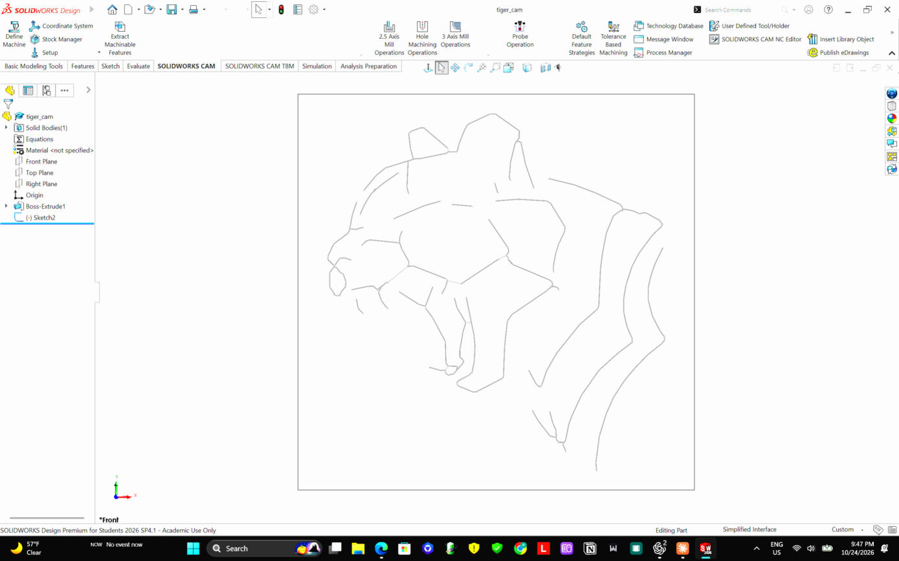

## 2. Define Machine: what machine will cut this?
Click **Define Machine** and pick **Mill – Metric**, a 3-axis mill in millimetres, which matches your router. Click **OK**.
The left panel now shows the CAM tree with the machine and its **tool crib**, the tools CAM is allowed to use.

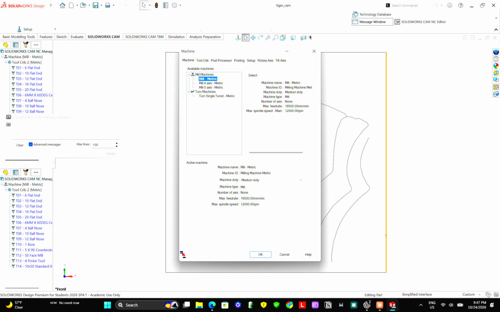

## 3. Stock Manager: what block are you cutting from?
Click **Stock Manager**. The default **bounding box** wraps the part exactly; here it's 100 × 100 × 3 mm. You can add offsets if the real board is bigger. The material only changes the suggested speeds. Click the green **✓**.

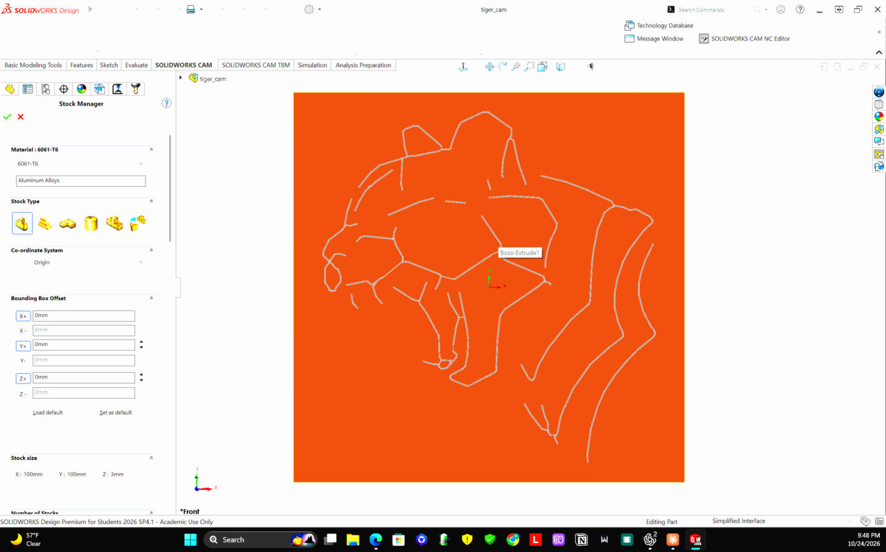

## 4. Setup: which side does the tool come from?
Click **Setup ▾ → Mill Setup**. CAM picks a plane or face, here the **Front Plane**, so the tool points straight into the face that has the drawing. Click **✓**.
The tree now shows **Mill Part Setup1**.

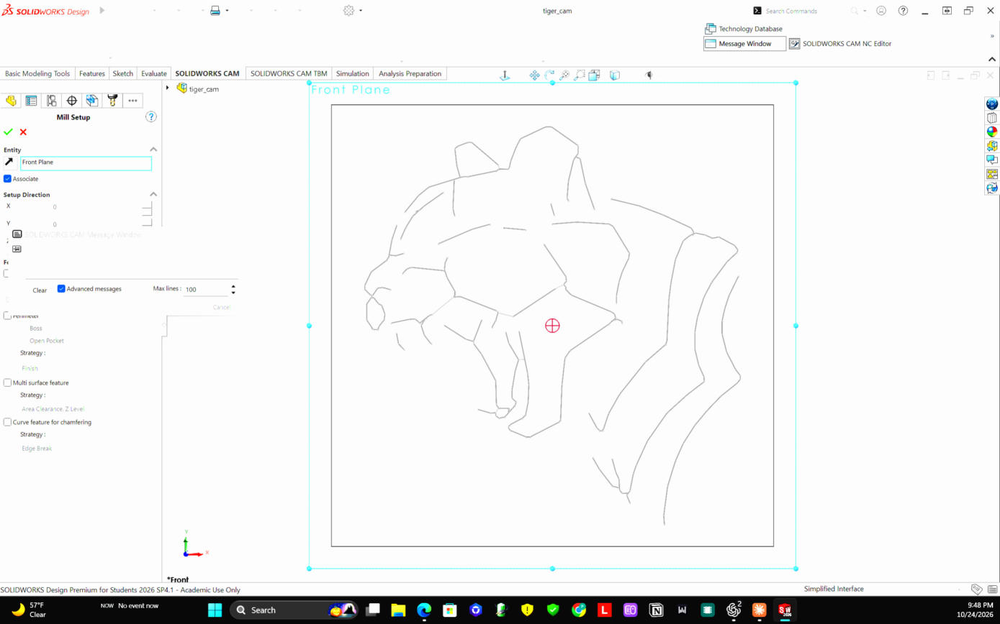

## 5. Tell CAM what to cut (the "feature")
Right-click **Mill Part Setup1 → 2.5 Axis Feature…**

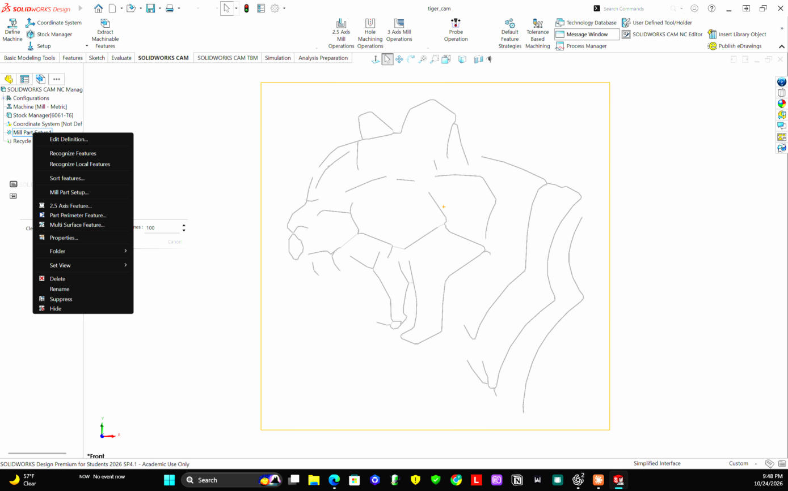

- **Type:** choose what kind of cut it is. **Pocket** clears an area, **Boss** cuts around a raised shape, and **Engrave Feature** follows lines. For the tiger, choose **Engrave Feature**.

  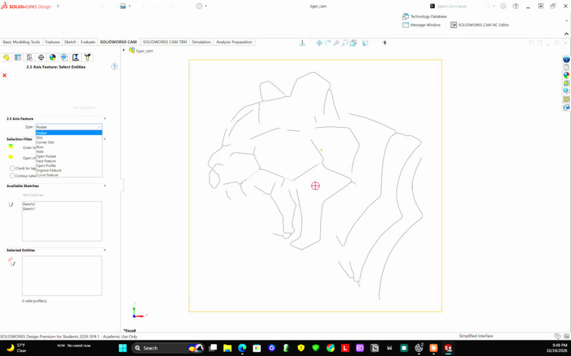
- **Available Sketches:** pick the sketch with the drawing (**Sketch2**). All its lines turn blue, and it should say **"1 valid profile"**.

  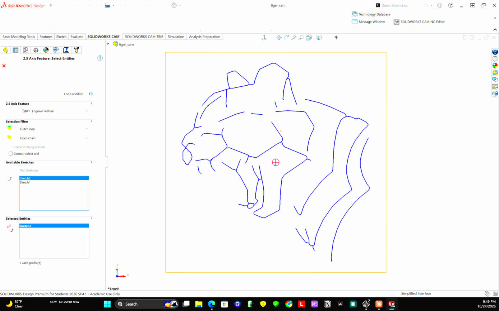
- Click **End Condition →** and set the depth: **Blind, 0.5 mm** for a light engrave. ⚠️ The default is 10 mm. Select the whole box before typing, or the numbers get added to the old value. Click **✓**.

  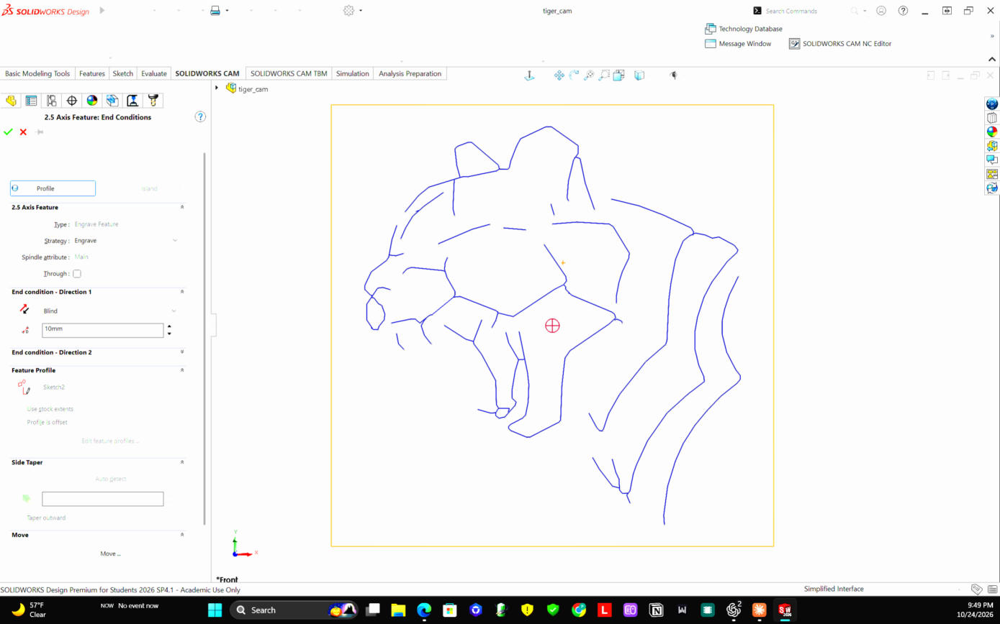

## 6. Generate Operation Plan: how should it be cut?
Click **Generate Operation Plan**. CAM picks an operation and a tool for each feature. Here it chose **Contour Mill1** with **T15, a 0.25 mm × 30° tapered ball-end** engraving tool.
To change the tool, depth per pass or feeds, right-click the operation and choose **Edit Definition**.

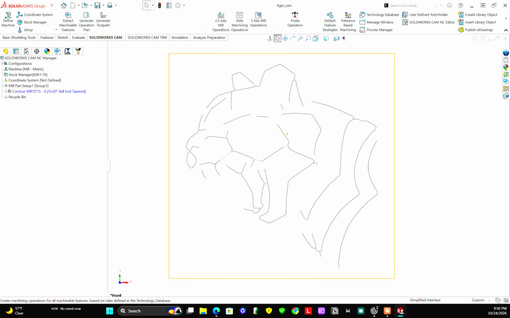

## 7. Generate Toolpath: the actual path
Click **Generate Toolpath**. New buttons appear: **Simulate Toolpath**, **Step Thru Toolpath** and **Post Process**.

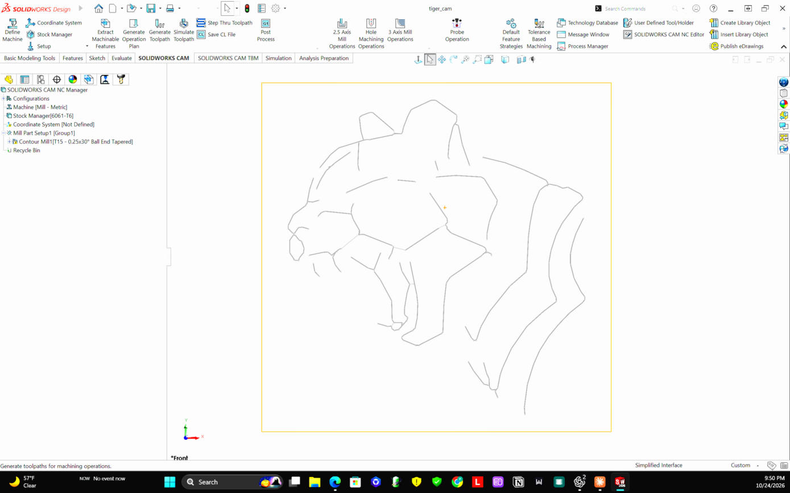

**To see the path drawn on the part**, the picture people post: switch to an isometric view (**Ctrl+7**), then click the operation (**Contour Mill1**) in the CAM tree.
- **Solid lines** are cutting moves.
- **Dashed lines** are rapid moves, where the tool lifts and jumps to the next line.

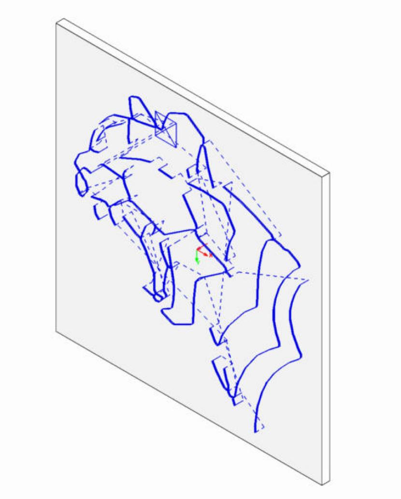

## 8. Simulate Toolpath: watch the tool cut
Click **Simulate Toolpath**, then **▶ Play**.
- **Speed slider:** drag it left to slow down. ◀◀ rewinds.
- **Display Options:** show or hide the tool, holder and stock.
- **Viewing the cut:** if you can't see the cuts, you're probably looking at the back of the stock. Click in the graphics area and press the **← arrow key 12 times** to spin the view 180°.

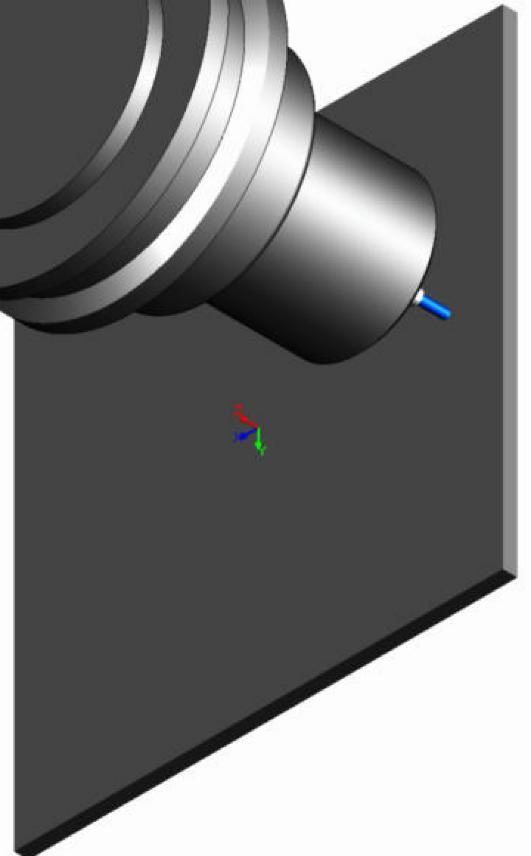

Click **✓** to leave the simulation.

---

## Important: don't send SolidWorks CAM's G-code to the Nano
**Post Process** turns the toolpath into G-code, but its included post-processors are written for industrial controllers, not GRBL. That G-code can include commands GRBL rejects, such as tool changes. For the real machine, keep using G-code made for GRBL: the files in `CNC\gcode`, or Fusion 360 with its **Grbl** post-processor.

## Doing it for a real cut later
- Set the **stock** to your real board size and material (wood/MDF).
- Make sure CAM uses a tool **you actually own**. For engraving, that's usually a V-bit; add it under **Tool Crib** if needed.
- Set **depth per pass** and **feeds** in the operation's **Edit Definition**.
