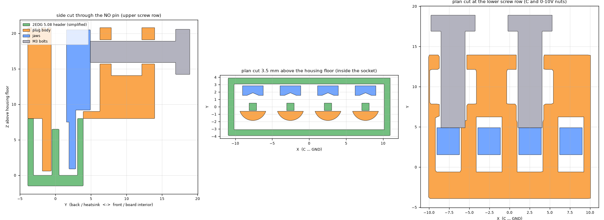

# Printed plug for the spindle header (C / NO / 0-10V / GND)

The 4-pin header on the JP-3163B board (just below the 2-pin 24V/GND plug) has lost its green screw plug. This printed plug pushes onto the bare pins. Each wire is clamped straight onto its pin by an M3 bolt.

> **Experimental.** The sizes come from the standard 2EDG-family 5.08 mm pluggable header (Degson's 2EDGVC-5.08 drawing: 1.0 mm square pins, 5.08 mm pitch, housing 5.08×N+2 long, 8.6 mm deep, 12 mm tall). The inside of the socket isn't dimensioned on the drawing, so the plug is kept slightly undersized there. That's fine, because the clamp doesn't depend on a tight fit. Print `fit_test.stl` first. Buying the real plug (**2EDGK-5.08-04P**, sold cheaply by most electronics sellers) is the easy alternative.

## How it works



Seen from above, each pin cell looks like this:

```
 back (heatsink side)                                     front (toward R11 / SW3 / big capacitor)
 | anvil |pin| wire |  jaw  |   nut + M3 bolt   |  <- bolt head here
                    <- the bolt tip pushes the jaw this way
```

- The **anvil** is part of the plug body. It fills the space between the housing's back wall and the pins, so each pin has a solid wall behind it.
- Each pin has its own small loose **jaw** (blue in the drawing). The bare strands go down between the pin and the jaw. Tightening the bolt pushes the jaw back, which squeezes the strands onto the pin. Higher up, the jaw also pinches the wire's insulation against the body, so a tug on the wire doesn't pull on the strands (strain relief).
- **Why the bolts are horizontal:** the clamping force goes around in a loop inside the plug (bolt → nut → body → anvil → pin → wire → jaw → bolt). Tightening therefore never pushes the plug off the header. A bolt pressing down on top of a pin would lift the plug straight off.
- **Why the nuts are in two rows:** the pins are 5.08 mm apart, but an M3 nut is 5.8 mm across. **C and 0-10V** use the lower row, and their nuts slide in from underneath. **NO and GND** use the upper row, and their nuts drop in from the top.

## 1. Check one number: the pin spacing

With **the box unplugged**, measure with calipers from the **centre of the C pin to the centre of the GND pin**, or from the outside edge of one to the outside edge of the other, and subtract one pin thickness (1 mm).

- **About 15.2 mm** (3 × 5.08): the STLs are already right, so just print.
- **About 15.0 mm** (3 × 5.00): set `PITCH = 5.00` at the top of `header_plug.py` and rebuild.
- **About 11.4 mm** (3 × 3.81): this design won't fit, because an M3 bolt is too big for that spacing. Solder the wires or buy the plug.

Everything else uses the standard 2EDG sizes. If the fit test shows a problem, `header_plug.py` lists every size at the top, each with a comment.

To rebuild (the first run downloads CadQuery, which takes about a minute):

```bash
uv run --python 3.12 --with cadquery python header_plug.py
```

```bash
uv run --python 3.12 --with cadquery --with matplotlib python check_and_render.py
```

The second command checks that nothing clashes with a simple model of the header. It also redraws `renders/`.

## 2. Print

All parts are PETG with a 0.4 mm nozzle, no supports, and the orientation is already set in the STLs.

| File | What | Settings |
|------|------|----------|
| `stl/fit_test.stl` | only the part that goes into the housing (about 10 min) | 0.16 mm layers, 100 % infill |
| `stl/plug_body.stl` | the plug, upside down (flat top on the bed) | 0.12–0.16 mm layers, 100 % infill (it's tiny), Arachne walls |
| `stl/jaws_x4.stl` | 4 jaws lying flat | 0.12–0.16 mm layers, 100 % infill, 3 mm brim (they're small) |

The thinnest wall is the jaw tip, at 1.3 mm. Fine layers help both it and the labels.

## 3. Fit test first

Push `fit_test.stl` into the empty header, with the side marked **C** toward the 24V/GND plug.

- It should go all the way down with a firm push and pull out by hand. If it's too tight, raise `FIT` by 0.05. If it's loose, lower it.
- If it sits a little high, that's OK. The clamp still works as long as the bottom 4 mm of each jaw is beside its pin.
- Look through the four windows. Each pin should stand just in front of the solid back tooth, with a gap of about 1 mm in front of it for the wire. If the outer pins are off but the middle ones look right, the pitch is wrong. If all of them are shifted toward one wall, adjust `PIN_Y`.
- If it won't go in, lower `SOCK_W` or `WELL_R` by 0.2. A bit of play is fine.

## 4. Assemble

Hardware: **4× M3 hex bolts, 12 mm** (10 mm is the bare minimum; 14 and 16 mm stick out more) and **4× M3 nyloc nuts**.

1. Push the nuts in. **C and 0-10V** go in from **underneath** the front block; **NO and GND** go in from the **top**. Line each one up with its bolt hole. If a slot is tight, warm the nut with a soldering iron and press it in.
2. Drop each jaw into its pocket from the top, with the thin end pointing down and the V-groove facing the back (toward the pins). Its foot rests on a small ledge.
3. Thread each bolt in from the front face just until its tip touches the jaw. Don't push the jaws yet.
4. With **the box unplugged**, push the plug onto the header. The **C** end goes next to the 24V/GND plug, and the bolt heads face the board interior. A label is printed next to each bolt.

## 5. Wire it

The wire colours come from `../spindle_vfd_setup.md`:

| Header pin | Wire | VFD terminal |
|-----------|------|--------------|
| NO | orange | FWD |
| C | brown | GND |
| 0-10V | red | 10V IN |
| GND | 4th wire | GND (same screw as brown) |

For each wire:

1. Strip **6 mm**. Twist the strands tight. If you can, **tin the tip** with a little solder: a stiff tinned end slides in easily and won't splay out.
2. Back the bolt out a turn. Feed the wire **straight down the channel behind the jaw**, the gap between the jaw and the back wall, until the insulation stops at the top of the pin, about 6 mm down.
3. Tighten the bolt firmly by hand with a 5.5 mm spanner or nut driver, then give it a quarter turn more. Don't crank it: the body is plastic.
4. **Tug test:** pull each wire firmly. It must not move.
5. **Continuity test** (multimeter beep mode): touch one probe to the far end of each wire. The other probe goes on the matching solder pad under the board, or on the top of the pin through the channel before the wire goes in. Wiggle the wire while it beeps: the beep must not drop out.

## Why it has to grip hard

These are low-voltage signals: a relay contact (C/NO) and a 0-10 V speed signal. A poor contact isn't a shock or fire risk here. But if **NO/C** loosens, the spindle **stops and starts by itself mid-cut**, and a loose **0-10V** makes the speed wander. Redo the tug and wiggle tests after the first few hours of running.

**Most reliable fallback:** solder the wires straight onto the pins, with heat-shrink over each joint. Solder is permanent, but it never works loose.

## Files

- `header_plug.py`: parametric CadQuery model. All sizes are at the top (standard 2EDG 5.08 header), and `main()` exports the STLs.
- `check_and_render.py`: clash checks against a simple header model, plus the drawings in `renders/`.
- `stl/`: `plug_body.stl`, `jaws_x4.stl`, `fit_test.stl`.
